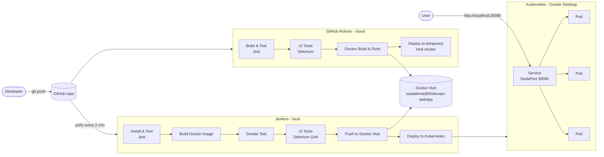
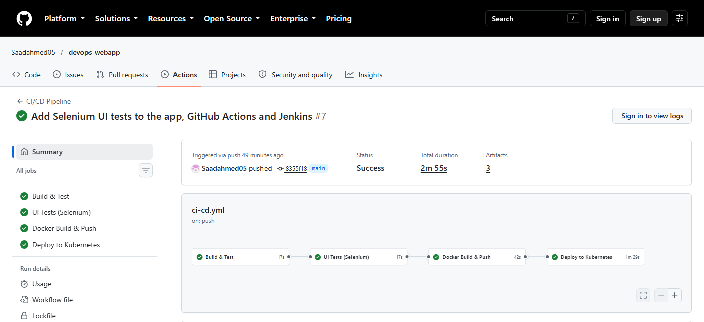
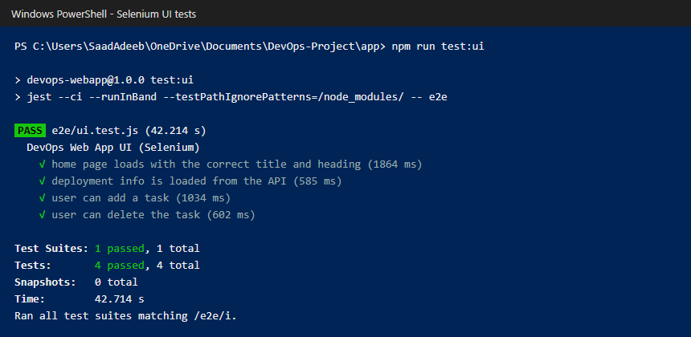
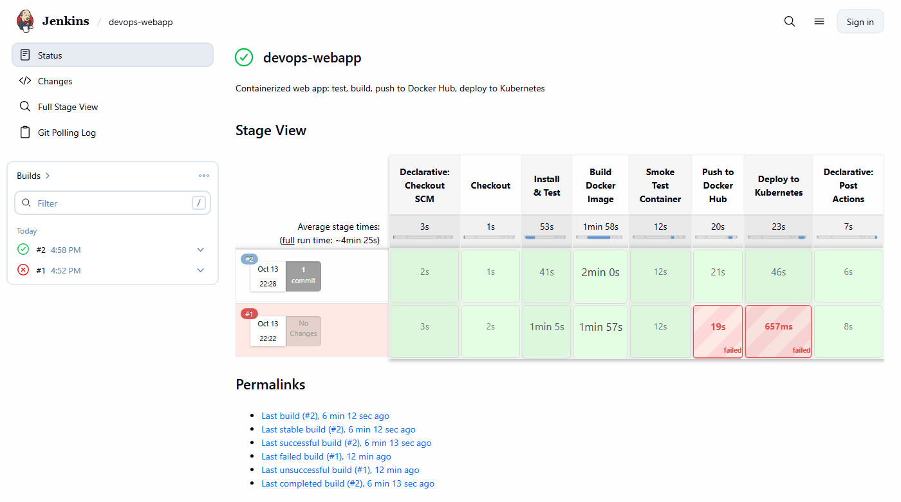
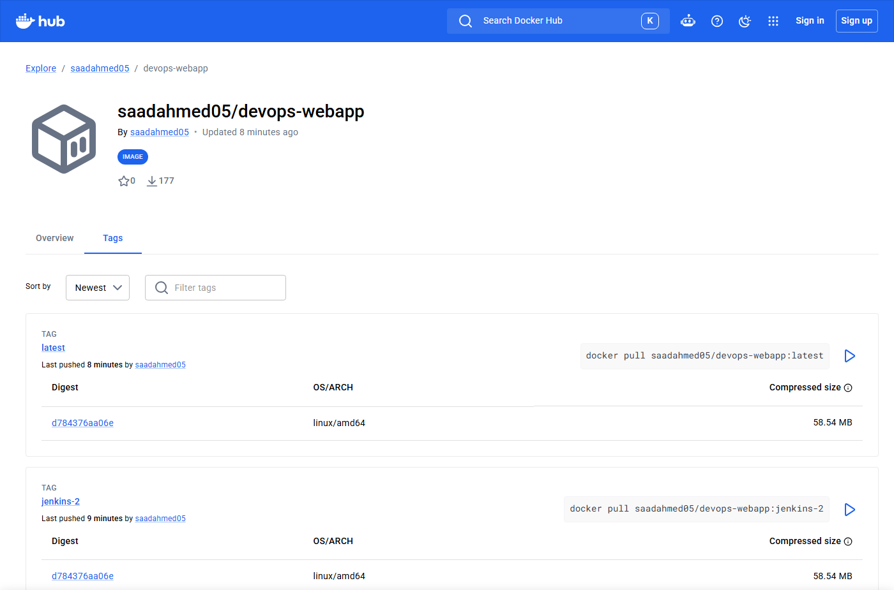
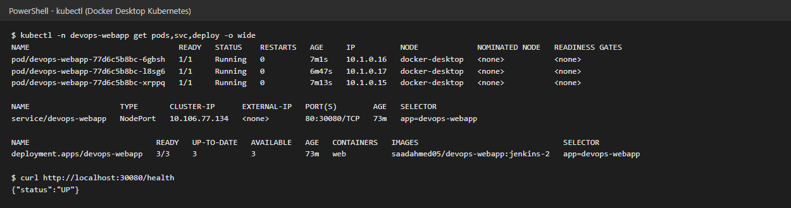
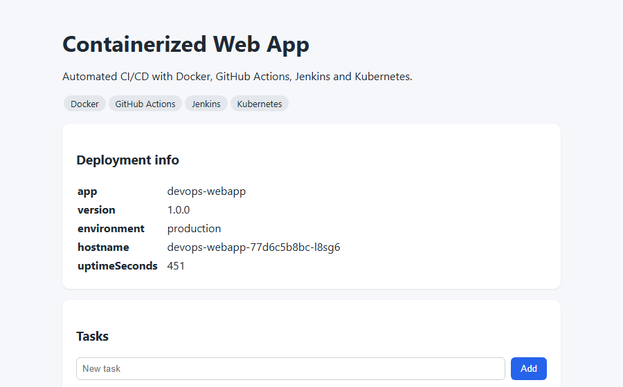

# Containerized Web Application with Automated CI/CD

[](https://github.com/Saadahmed05/devops-webapp/actions/workflows/ci-cd.yml)


A DevOps lab project. A Node.js task-manager web app is containerized with **Docker**, tested with
**Jest** and **Selenium**, built and shipped by two CI/CD pipelines (**GitHub Actions** and **Jenkins**),
published to **Docker Hub**, and deployed to **Kubernetes** with zero-downtime rolling updates.

Every `git push` to `main` runs the whole flow automatically: test, build, push, deploy.

---

## Contents

- [Architecture](#architecture)
- [Features](#features)
- [Tech stack](#tech-stack)
- [Project structure](#project-structure)
- [Getting started](#getting-started)
- [CI/CD pipelines](#cicd-pipelines)
- [Testing](#testing)
- [Screenshots](#screenshots)
- [Demo guide](#demo-guide)
- [Troubleshooting](#troubleshooting)
- [Team](#team)

---

## Architecture



- **GitHub Actions** runs in GitHub's cloud. It can't reach a cluster on a local PC, so its deploy job
  creates a temporary Kubernetes cluster ([kind](https://kind.sigs.k8s.io/)) inside the runner, deploys
  the image it just pushed, and checks `/health`.
- **Jenkins** runs on the local PC in Docker and deploys to the real **Docker Desktop Kubernetes** cluster.
- If a deployment fails, both pipelines roll back automatically with `kubectl rollout undo`.

---

## Features

**Application**
- Task manager UI: add, list and delete tasks (REST API at `/api/tasks`)
- `/health` endpoint used by Docker `HEALTHCHECK` and Kubernetes probes
- `/api/info` shows which container or pod served the request, which makes load balancing visible
- Graceful shutdown on `SIGTERM`, so rolling updates don't drop requests

**DevOps**
- Multi-stage Docker build, non-root user (UID 1000), built-in health check
- Two CI/CD pipelines doing the same job: GitHub Actions (hosted) and Jenkins (self-hosted)
- Unit/API tests (Jest + Supertest) and browser UI tests (Selenium WebDriver)
- Smoke test of every image before it is pushed
- Images tagged by commit SHA (GitHub Actions) and build number (Jenkins), plus `latest`
- Kubernetes: 3 replicas, rolling updates with `maxUnavailable: 0`, readiness and liveness probes,
  resource limits, ConfigMap, NodePort Service and Horizontal Pod Autoscaler
- Jenkins configured entirely as code (JCasC + Job DSL): admin user, credentials and pipeline job are created automatically
- Secrets are never committed: GitHub encrypted secrets and a git-ignored `jenkins/.env`
- Automatic retries for flaky network steps (Docker Hub push, image build)

---

## Tech stack

| Area | Tools |
|---|---|
| Application | Node.js 22, Express, HTML/CSS/JavaScript |
| Testing | Jest, Supertest, Selenium WebDriver (Chrome / Edge) |
| Containers | Docker, Docker Compose |
| Registry | Docker Hub |
| CI/CD | GitHub Actions, Jenkins (Declarative Pipeline, JCasC, Job DSL) |
| Orchestration | Kubernetes (Docker Desktop), kind, kubectl |
| Version control | Git, GitHub |

---

## Project structure

```
devops-webapp/
├── app/
│   ├── src/
│   │   ├── app.js              Express routes and REST API
│   │   └── server.js           server start and graceful shutdown
│   ├── public/index.html       frontend UI
│   ├── tests/app.test.js       Jest + Supertest unit/API tests
│   ├── e2e/ui.test.js          Selenium browser UI tests
│   └── package.json
├── Dockerfile                  multi-stage image build
├── docker-compose.yml          run the app locally with one command
├── .github/workflows/ci-cd.yml GitHub Actions pipeline
├── Jenkinsfile                 Jenkins pipeline
├── jenkins/
│   ├── Dockerfile              Jenkins + Node.js + Docker CLI + kubectl
│   ├── casc.yaml               Jenkins Configuration as Code
│   ├── .env.example            template for local secrets (copy to .env)
│   └── docker-compose.yml      run Jenkins locally
├── k8s/
│   ├── namespace.yaml
│   ├── configmap.yaml          app version shown in the UI
│   ├── deployment.yaml         3 replicas, rolling update, probes
│   ├── service.yaml            NodePort 30080
│   └── hpa.yaml                autoscale 2-6 pods on CPU
├── docs/screenshots/           pipeline, Kubernetes and Selenium screenshots
├── DEMO-GUIDE.md               step-by-step demo script
└── README.md
```

---

## Getting started

### Prerequisites

- [Docker Desktop](https://www.docker.com/products/docker-desktop/) with **Kubernetes enabled**
  (Settings → Kubernetes → Enable Kubernetes)
- [Node.js 22](https://nodejs.org/) and Git
- Chrome or Edge (for Selenium tests)

### 1. Run locally (no Docker)

```bash
cd app
npm install
npm test        # unit/API tests
npm start       # http://localhost:3000
```

### 2. Run with Docker

```bash
docker compose up --build -d   # http://localhost:3000
docker ps                      # STATUS shows (healthy)
docker compose down
```

### 3. Deploy to Kubernetes

```bash
docker build -t devops-webapp:latest .
kubectl apply -f k8s/namespace.yaml
kubectl apply -f k8s/
kubectl get all -n devops-webapp
```

Open http://localhost:30080. Refresh a few times and the **hostname** changes between pods.

Useful commands:

```bash
kubectl scale deployment devops-webapp --replicas=5 -n devops-webapp            # scale
kubectl delete pod <pod-name> -n devops-webapp                                  # self-healing
kubectl rollout history deployment/devops-webapp -n devops-webapp               # versions
kubectl rollout undo deployment/devops-webapp -n devops-webapp                  # rollback
```

---

## CI/CD pipelines

### GitHub Actions

Workflow: [`.github/workflows/ci-cd.yml`](.github/workflows/ci-cd.yml). Runs on every push and pull request to `main`.

| Job | What it does |
|---|---|
| **Build & Test** | `npm ci`, Jest tests with coverage |
| **UI Tests (Selenium)** | starts the app and runs the Selenium tests in headless Chrome |
| **Docker Build & Push** | builds the image, pushes `saadahmed05/devops-webapp:<sha>` and `:latest`, smoke-tests it |
| **Deploy to Kubernetes** | creates a kind cluster, deploys the new image, waits for rollout, checks `/health` |

**Setup:** create a Docker Hub access token (Read & Write) and add it in
**Settings → Secrets and variables → Actions** as `DOCKERHUB_TOKEN`.

### Jenkins

Pipeline: [`Jenkinsfile`](Jenkinsfile). Stages:

**Checkout → Install & Test → Build Docker Image → Smoke Test Container → UI Tests (Selenium) → Push to Docker Hub → Deploy to Kubernetes**

For the Selenium stage, Jenkins starts the new image and a `selenium/standalone-chrome` container on a
private Docker network and runs the tests through Selenium Grid.

**Setup:**

1. Create a kubeconfig Jenkins can use from inside Docker:
   ```bash
   kubectl config view --minify --flatten --context docker-desktop | sed 's#127.0.0.1#kubernetes.docker.internal#' > jenkins/kubeconfig
   ```
2. Copy `jenkins/.env.example` to `jenkins/.env` and fill in an admin password and your Docker Hub token.
   (`.env` and `kubeconfig` are git-ignored.)
3. Start Jenkins:
   ```bash
   cd jenkins
   docker compose up -d --build
   ```
4. Open http://localhost:8090 and sign in. The **devops-webapp** job already exists. It polls GitHub
   every 2 minutes and builds new commits automatically, or you can click **Build Now**.

Jenkins uses port **8090** because 8080 is often taken by other Java programs.

---

## Testing

| Type | Tool | Command | What it checks |
|---|---|---|---|
| Unit / API | Jest + Supertest | `npm test` | `/health`, `/api/info`, the HTML page, task CRUD, validation |
| UI (end-to-end) | Selenium WebDriver | `npm run test:ui` | page title and heading, deployment info loads, add a task, delete a task |

Selenium options (environment variables):

| Variable | Default | Purpose |
|---|---|---|
| `APP_URL` | `http://localhost:3000` | app to test |
| `BROWSER` | `chrome` | `chrome` or `MicrosoftEdge` |
| `HEADLESS` | `true` | `false` shows the browser window |
| `SLOW` | `false` | `true` pauses between steps (good for demos) |
| `SELENIUM_REMOTE_URL` | none | run on a Selenium Grid (used by Jenkins) |
| `SCREENSHOT_DIR` | none | save a screenshot after each test |

Visible demo in PowerShell:

```powershell
cd app
$env:HEADLESS="false"; $env:SLOW="true"; npm run test:ui
```

---

## Screenshots

**GitHub Actions: all jobs passed, including Selenium**


**Selenium UI tests passing**


**Jenkins Stage View**


**Docker Hub image tags pushed by both pipelines**


**Kubernetes: 3 pods running the image built by Jenkins**


**App served by Kubernetes (hostname is the pod name)**


---

## Demo guide

[DEMO-GUIDE.md](DEMO-GUIDE.md) is a 25–30 minute step-by-step script with every command to run and what
to point out: Docker, Docker Hub, Kubernetes (load balancing, self-healing, scaling, rollback), and a
live `git push` that triggers both pipelines.

---

## Troubleshooting

| Problem | Fix |
|---|---|
| Docker Desktop closes or won't start | Restart Windows, then open Docker Desktop |
| `port is already allocated` on 3000 | `docker compose down` |
| Jenkins page doesn't open | `cd jenkins` then `docker compose up -d` (port 8090) |
| Pods stuck in `CreateContainerConfigError` | rebuild the image; the Dockerfile must use the numeric `USER 1000:1000` |
| Selenium tests time out locally | the PC is overloaded; stop Jenkins (`docker stop jenkins`) and retry |
| Tasks disappear after refresh on port 30080 | expected: each pod keeps tasks in memory; a shared database is future work |

---

## Future scope

- Persistent database (PostgreSQL / MongoDB) with StatefulSets and Persistent Volumes
- Deploy to a managed cloud cluster (AWS EKS, Azure AKS, Google GKE)
- Monitoring with Prometheus and Grafana
- Helm charts and GitOps with Argo CD
- Image scanning (Trivy) and code quality checks (SonarQube) in the pipeline

---

## Team

DevOps Lab project, Department of CSE (AI & ML), Vidya Jyothi Institute of Technology.

- **Mohammed Mutasim Sulaiman**
- **Saad Khazi Ahmed** ([@Saadahmed05](https://github.com/Saadahmed05))
